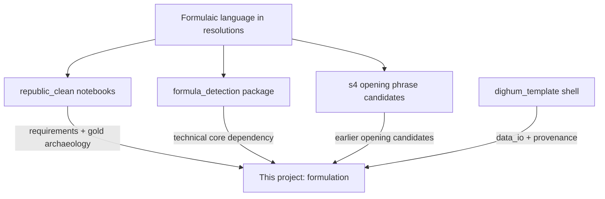
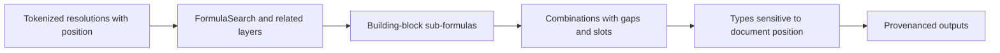

# Conceptual overview: formula work in `formulation`

Canonical research notions. Execution lives in [`PLAN.md`](../PLAN.md) and [`plans/`](../plans/). Source inventory and port list remain under [`formulator-project-docs/`](../formulator-project-docs/). Published framing: [`research-publications.md`](research-publications.md).

## What “formulas” means here

In REPUBLIC (Resolutions of the Dutch States General), **formulas** are recurring *templated* stretches of language — openings, decisions, “in handen van …”, role phrases (*hoedanigheden*), and similar — not mathematical equations.

They vary in spelling and in variable slots (names, places, dates) while keeping a recognisable skeleton. The research problem is: **find, group, and type those skeletons** across a large historical corpus despite orthographic variation and nested document structure.

### Formula-in-effect (operational — locked 2026-10-26)

A stretch counts as a formula only if **all** hold:

1. **Recurrence** — formulaicity *is* repetition (hapax ≠ formula); see Doc B frequency roles in [`formula-abstraction-design.md`](formula-abstraction-design.md).
2. **Skeleton** — a reduced hinge under orthographic/OCR drift; fillers do not define the type.
3. **Function** — a recognisable procedural/discourse move (open, refer, decide, resume, …), not topic content.
4. **Composition / gaps** — may be a short building block or a longer composition; need not be one contiguous n-gram.
5. **Position interprets** — same skeleton can mean different things by zone; place does not invent formulaicity alone.

**Ontology (what is real):**

| Real | Role |
|------|------|
| **Hinge** | Minimal recurring skeleton with a discourse function |
| **Composition** | Ordered co-occurrence of hinges (sometimes gappy: F1a…F1b) |
| **Named formula / template** | Human claim that a hinge (rarely a frozen composition) is a catalogue type |
| **Variant / surface** | Spelling, slot filler, period inventory — not a new type |

**Harvest rows are witnesses; they are not almost-formulas.** 5-gram dumps, fold families, overlap edges, and sequence-matrix nodes attest recurrence, straddles, or chains — they do not mint types. See [`DECISIONS.md`](DECISIONS.md) 2026-10-26 redesign pause.

**Working catalogue band (18c procedural):** ~15–30 hinges; ~25–50 human-named types. Six opener blueprints is too few (missing decision scaffolding); hundreds of named ids almost certainly oversplit variants; ~10³ fold families are archaeology, not the target count.

**Too wide / too small:** a witness that covers more than one move → split at function boundaries and keep the long string as composition evidence; a witness shorter than a move → glue, tail, or name (or F1b of an existing hinge), not a formula. Adjudicate witnesses **post hoc** against proposed hinge-sized archetypes (prefer char n-gram TF-IDF soft membership: near / mid / far) — archetypes first, phrases second; mid scores do not auto-mint.

## Core research notions

### Formulas have building-block sub-formulas

Longer formulaic expressions often contain **shorter sub-formulas** that act as reusable building blocks. Not every frequent 2- or 3-word string qualifies. We need explicit **criteria for “building block” status**, for example (to be refined):

- Recurs as a stable unit across many resolutions / years (not just local repetition)
- Appears in more than one larger formula type (compositional reuse)
- Survives orthographic variation as the same skeleton
- Carries a recognisable discourse or procedural function (opening move, referral, decision cue, …)
- Is productive with variable slots around or inside it — not a frozen hapax collocation

Criteria are part of the scientific design of this project, not an afterthought of n-gram mining.

### How building blocks combine

Larger formulas are **compositions** of these blocks (plus variable material), not flat bags of words. Open questions the project should make answerable:

- Which blocks co-occur or order-constrain each other?
- Which combinations form attested larger formula types vs accidental adjacency?
- Where does a block boundary end and a variable (name, date, body) begin?

Graph / sequence views from the `republic_clean` “formula elements” work are early attempts at this composition story; `formula_detection`’s motif / co-occurrence layers are machinery that can support it.

### Shorter formulas need not be contiguous

Building blocks (and the larger formulas they form) **need not be contiguous token spans**. Variable parts — person names, places, dates, case-specific content — may sit **between** stable formulaic pieces.

Detection and representation must allow **gappy / templated patterns** (fixed skeleton + slots), not only unbroken n-grams. That aligns with `FormulaSearch`’s notion of phrases with variable elements, and with earlier fuzzy / template search in the notebooks.

### Position in the resolution matters

The **same (or closely related) formula can mean different things depending on where it appears** in a resolution’s discourse structure. Example:

- A formula that marks a **decision** near the **end** of a resolution
- may signal **resumption** when the same cue appears in the **opening** (*proposition*)

So formula identity is not only string/skeleton identity: **rhetorical / document position** (opening vs body vs decision zone, and relations between zones) is part of interpretation and possibly of typing. Pipelines should retain span offsets or section labels, not only phrase types.

## Earlier candidate material (extra source)

Besides `republic_clean` notebooks and the `formula_detection` package, there is an earlier machine-generated candidate set:

- `~/develop/republic_ner_matching/output/s4_opening_phrase_candidates.jsonl` (register via the manifest; never hardcode in Python)

Shape (sampled): one JSON envelope with **271** frequency-ranked opening n-grams (`phrase`, `count`, `word_count`), kept at `minimum_frequency=5`, after excluding gold dates from tier-1 resolution text. Examples: `ontfangen een` / `ontfangen een missive` / `is gelesen` / `ontfangen een missive van`. Word lengths are mostly 2–5.

These are useful as an additional seed inventory of formulaic openings to compare, filter, and reinterpret under the building-block / position notions above. Treat as candidate archaeology (like gold tables), not as ground truth.

**Gaps relative to our notions:** records have **no span or document-position fields**, and many short items (e.g. bigrams) still need building-block criteria — frequency alone does not decide which are compositional units vs fragments of longer openings.

Sample notes: [`formulator-project-docs/internal-context/s4-opening-phrases-sample.md`](../formulator-project-docs/internal-context/s4-opening-phrases-sample.md).

## Two lineages (same problem, different maturity)

### 1. `republic_clean` notebooks — domain prototypes

Exploratory REPUBLIC work: writeups, year-by-year clustering, graphs of formula *elements*, links to *hoedanigheden*, hand-curated CSV/XLSX tables, some Flair tagging experiments.

- Backed by **live Elasticsearch** and hard-coded local paths
- Uses `republic.*` helpers and `fuzzy-search`, **not** the published `formula_detection` package
- Best treated as **problem framing + labelled reference material**, not as application code to copy

### 2. `formula_detection` — reusable library

Marijn Koolen’s published package ([PyPI](https://pypi.org/project/formula_detection/) / [GitHub](https://github.com/marijnkoolen/formula_detection)). Core idea: **`FormulaSearch`** over tokenized texts builds vocab/co-occurrence structure and surfaces candidate formulaic phrases (contiguous or with variable slots).

Around that core sit orthographic normalisation/variants, motif/boundary helpers, clustering/typing, and REPUBLIC-oriented **iterables** (`resolution_iterables.py`) that turn corpora into token streams.

This is the **technical core to depend on**, not fork.

### 3. S4 opening-phrase candidates — earlier inventory

Frequency-ranked opening n-grams from `republic_ner_matching` (271 candidates in the current file). Complements notebook gold and library demos as another prior pass over formulaic openings; to be loaded via manifest paths when the project ingests seed lists. Reinterpret with building-block criteria and (when possible) re-attach position in the resolution.

### 4. This project — dighum shell + domain pipeline

Bootstrapped from `dighum_template`: Python/uv, `data_manifest.toml`, `data_io` with provenance. The intended evolution is a thin **project layer** that:

- feeds clean token streams into `FormulaSearch`
- represents **gappy building blocks** and their **combinations**
- keeps **document position** with candidates (for cues like decision vs resumption)
- writes outputs through `data_io`
- uses ES-free sample/frozen corpora plus seed lists (notebook gold, S4 openings)
- lifts *ideas* from the notebooks without lifting the notebook tree

## Mental model of the detection pipeline

1. **Input:** iterable of token lists (any tokenizer; often `fuzzy-search` tokens), with enough structure to recover **position in the resolution**.
2. **Index:** term frequencies, skip/co-occurrence filtering.
3. **Building blocks:** candidate short formulas that meet **building-block criteria** (not raw short n-grams).
4. **Composition:** how blocks combine into larger formulas, allowing **non-contiguous** skeletons with variables between them.
5. **Position-aware typing:** interpret / label formulas using where they occur (e.g. decision-final vs opening resumption).
6. **Project wrap:** manifest paths + provenance sidecars (what the dighum shell adds).

## What to keep vs leave behind

| Keep / evolve | Leave behind (for now) |
|---------------|------------------------|
| `FormulaSearch` + vocab/candidate pipeline | Copying the whole notebook tree |
| Resolution/corpus iterables pattern | Live ES as a hard dependency |
| Writeup concepts (why formulas; elements; hoedanigheden) | Downloads-path loaders, mega output notebooks |
| Building-block criteria + composition + position | Treating every frequent bigram/trigram as a formula |
| Curated labelled tables + S4 opening candidates (path-cleaned) | Flair `.pt` models unless tagging becomes a goal |
| dighum `data_io` + provenance | Forking/vendoring all of `formula_detection` |

## Suggested reading order (conceptual)

1. `formulas_writeup.ipynb` — why REPUBLIC needs formulas
2. `formulas_elements_writeup.ipynb` — formula *elements* as graph pieces (composition precursor)
3. `formula_detection` README / `FormulaSearch` — how detection works mechanically (incl. variable elements)
4. `docs/Document-Pattern-Detection-Findings.md` (in the package) — design rationale
5. `notebooks/resolution_iterables.py` (in the package) — how REPUBLIC texts become token streams
6. `s4_opening_phrase_candidates.jsonl` — earlier opening-candidate inventory

## Implication for this project

**Shell is ready; domain layer is the work.** The locked target model is **hinges + compositions + human-named types**, with harvest as witness evidence only (see Formula-in-effect above). Flat phrase lists and family folds are archaeology. Track F `FormulaSearch` remains a possible later instrument for recurrence-validated skeletons (L3), not a substitute for the ontology.

**Design questions** (how far templates get us; discrimination; formulas↔templates; harvest speed; detection feasibility): [`template-design-questions.md`](template-design-questions.md). Prefer small empirical probes that cite the locked ontology over new harvest patch ladders.
