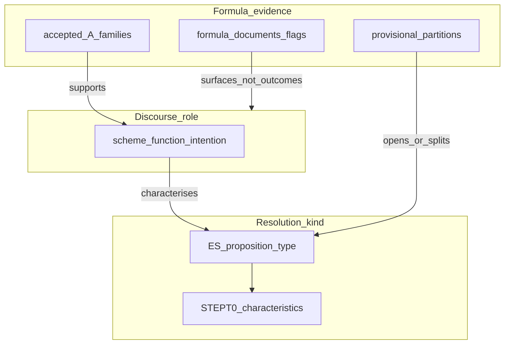

# STEPT1-map — Typology ↔ formula characteristics (NOTES)

**Goal:** One place that says what is being typed. Resolution kinds + characteristics first; formula detectors as evidence — not free-floating classes.  
**Status:** done (docs only; no new scorer). **STEPT1e1 parked** until a characterisation gap from this map names the next measurement.

**Sources:** `typology_structural_profile` (1780 STEPT0); [`formula_schemes_sample.json`](formula_schemes_sample.json); STEPT1a / [T1a2](STEPT1a2-advies-formula-type.md) / [T1e](STEPT1e-partition-probe.md) NOTES; [`docs/template-design-questions.md`](../../template-design-questions.md).

**Scheme lock:** The schemes sample is a **hypothetical** discourse/role sketch, not a closed inventory. Resolutions may **not fit fully**; they should usually fit **partially** (some roles/blocks present, others missing, order or composition off). Non-fit or partial fit is evidence for refining the sketch — not a classification failure and not grounds to force a flag bucket or a new A family.

## 1. Layers (keep distinct)

| Layer | Question it answers | Not |
|-------|---------------------|-----|
| **Resolution kind** | What kind of sitting/document is this? (ES `proposition_type`) | A formula string |
| **Characteristics** | How does that kind look? (STEPT0 zones, length, flag combos) | A detector score |
| **Discourse role** | What move does a stretch make? (scheme `function` / `intention`, **hypothetical**) | A population class or closed checklist |
| **Formula evidence** | Can we recognise a skeleton that supports a kind or role? | The typology itself |

Collapsing these into one “class” is why Track T felt like classification without typology. Partial scheme coverage of a resolution is the expected default.

## 2. STEPT0 resolution kinds (1780, composition)

Population from full-year ES agg (not the floored sample). Characterisation sample is floored — do not read sample_n as mix.

| Kind | pop | pct | words med | Characteristic formula shape (flags / top combos) |
|------|----:|----:|----------:|---------------------------------------------------|
| **missive** | 1489 | 0.475 | 83 | `ontfangen_start` 0.91; top = `advertentie`+`geen_resolutie`+`ontfangen`; also decisionful half (`gedelibereert` 0.48, `goedgevonden` 0.31) |
| **rekest** | 761 | 0.243 | 210 | Decision-heavy: `goedgevonden` 0.95, `gedelibereert_start` 0.76; little ontfangen (0.07) |
| **onbekend** | 460 | 0.147 | 96 | Join coverage only 0.16 — upstream untyped; sparse flags expected |
| **voordracht** | 154 | 0.049 | 144 | `gedelibereert`+`goedgevonden`+`vergaderinge` |
| **rapport** | 105 | 0.034 | 410 | `rapport_start` 0.82 + decision flags; long |
| **conclusie** | 62 | 0.020 | 124 | `goedgevonden`+`handen`/`in handen` (defer/routing) |
| **memorie** | 46 | 0.015 | 162 | Mixed; `memorie_start` in combos |
| **advies** | 32 | 0.010 | 482 | `advies` flag 0.93 + long; ES gold for T1a2 |
| tail | ≤10 each | | | `resolutie`, `paspoort`, `consent`, … — too thin for characterisation claims |

**Composition vs characterisation:** missive and rekest dominate and already separate structurally (short info/missive vs long decision/rekest). Tail kinds need characterisation before any new formula “type” claims them.

## 3. Crosswalk (schemes × STEPT0 × measured status)

| Phrase / family | Scheme role | Scheme → kind | Measured status | Notes |
|-----------------|-------------|---------------|-----------------|-------|
| `ontfangen_start` | proposition / opening | missive | **Provisional partition** (T1e: P(missive\|ont+) 0.928) | Not accepted formula type; opens ~half of 1780; ≠ L1 (only ~48% of ont+) |
| `advertentie` | exposition | missive | Flag / scheme only | Co-occurs with null path under ontfangen |
| `geen_resolutie` | conclusion / null | missive | Flag only; L1 cue | Not a resolution class |
| `requeste_start` / `request_start` | proposition / opening | request(e) | Provisional / thin late bins | Scheme says request; ES label is `rekest` |
| `gedelibereert_start` | proposition / opening | request, rapport, memorie | Flag + ubiquitous under rekest | Also appears under missive residual (decisionful) — role ≠ kind |
| `rapport_start` | (scheme thin) | rapport | Flag-heavy on ES `rapport` | No accepted A family |
| `advies` | decision/reference | any / ES `advies` | **Accepted** T1a2 (recall 0.762, FP 0.034) | Supports kind `advies`; flag alone ≠ gold |
| appointment (`welkom`/`sessie`) | (not in schemes sample) | hides in missive/opening | **Accepted** T1a (recall 0.829, FP 0) | Resolution subtype / retrieval type, not ES `proposition_type` |
| `goedgevonden` / `verstaen` / `geresolveerd` | decision | any | Flag only | Ubiquitous → **overloaded**; not typology classes |
| `handen` / `in handen` | defer / routing | any (strong on `conclusie`) | Flag only | Discourse stage, not kind |
| `geexamineert` / `geëxamineert_start` | reference/defer | rapport/memorie | Flag / scheme | Expose/defer stage |
| `welkom` (scheme) | conclusion / installation | request | Part of appointment family | Scheme row ≠ standalone type |
| `praeside_start` / `praesentibus_start` | — | — | Leakage | Attendance openers on resolution rows — not resolution signal |
| `betalinge` / `paspoort` / `forma` / `voldoen` / `eed` | action / conclusion | various | Scheme only | No measured A; execution/tail |

## 4. Inventory buckets

### Accepted formula types (may support a kind)

| Id | Supports | Evidence |
|----|----------|----------|
| `appointment_installation` (welkom/sessie) | Aanstellingsresolutie (R1); often under missive opener | T1a PASS |
| `advies_geleesen` | ES `proposition_type=advies` | T1a2 PASS |

### Provisional partitions (structure cuts, not types)

| Cut | What it does | Not |
|-----|--------------|-----|
| ontfangen+ / − | Early DAG root; missive-aligned opening | Formula type; L1; ES missive identity |
| L1 missive_receipt | Null-decision receipt under opener | Full missive kind |
| Zone (opening/body/close) | Discriminator for same cue in different place | Template inventory |

### Scheme roles without detector

Most of [`formula_schemes_sample.json`](formula_schemes_sample.json): `advertentie`, `requeste_start`, `rapport_start`, `geexamineert`, action/conclusion phrases (`betalinge`, `paspoort`, `forma`, `voldoen`, `eed`, …). Hypothetical sketch only — expect partial presence on real resolutions.

### Misnamed / overloaded

| Surface | Problem |
|---------|---------|
| `goedgevonden` / `verstaen` | Present on almost every decisionful kind → cannot define a resolution class |
| `gedelibereert_start` | Scheme = opening for rekest/rapport; also mid-discourse under missive residual |
| `ontfangen_start` as “type” | Partition root, not a catalogue formula type |
| Flag buckets as typology | Discourse-stage labels without kind + characteristics |

## 5. Gaps named from the map (characterisation, not classification)

1. **Missive is not one kind structurally** — STEPT0 + T1e: info/null path vs decisionful residual under the same opener. Needs characterisation of *missive subtypes* (not a flag sieve as typology).
2. **Rekest is decision-shaped** — dominant second kind; scheme `requeste` / `gedelibereert` align, but no accepted opening A family with the discipline of T1a/T1a2.
3. **Rapport / memorie / conclusie** — distinct STEPT0 shapes (length, `rapport_start`, handen); scheme roles exist; **no** measured formula types.
4. **Advies** — rare kind with accepted detector; characterisation is long + flag-rich; do not confuse with `formula_documents.advies` wording alone.
5. **Appointment** — accepted formula / retrieval type **outside** ES `proposition_type`; typology must allow subtypes that are not ES labels.
6. **onbekend** — leave; sparse join is expected, not a detector target.

## 6. Call

**PASS** (map written; typology-before-classify locked).

1. Object of typing = **resolution kinds + characteristics**. Formula detectors **support** kinds/roles; they are not the typology.
2. **Park STEPT1e1** — flag bucketing without a named kind-gap would classify surfaces, not types.
3. **No new A family** until a gap above is chosen as the next *characterisation* or *kind-support* probe (e.g. missive subtype profile, or rekest/rapport opening measure against ES kind — not another sparse spoke for bag density alone).
4. Prefer re-reading / widening STEPT0 characteristics for under-described kinds over discourse-flag sieves.
5. Schemes remain a **hypothetical** role vocabulary; promote a scheme row only when it has kind characteristics and (eventually) measured evidence. Partial / non-fit revises the hypothesis — it does not invent classes.

**Next (after clear chat):** pick one characterisation gap from §5 — default lean: **missive subtype characterisation** under ontfangen+ (info vs decisionful) as a STEPT0-style profile, still docs/metrics, not a new accepted formula type. Or name rekest/rapport if that is the research priority.

**Update:** [STEPT1f](STEPT1f-missive-subtype-characterisation.md) circular on L1 half. [STEPT1g](STEPT1g-residual-structure-probe.md) **PASS** — residual = filler mass + sparse appointment; next = named sparse unexplained shape or park.
