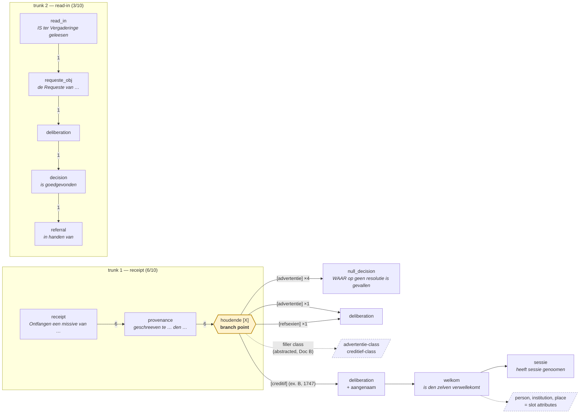

# Resolution graph (Doc A: the object)

**Status:** design note, rev. 2 (2026-10-21). Companion: [`formula-abstraction-design.md`](formula-abstraction-design.md) (Doc B) — this doc defines the *structure*; Doc B defines how its nodes get *typed*. Neither supersedes the STEPT1d/T1i/T1m/T1o bag machinery until a probe earns the replacement.

**Rev 2 exists because rev 1's concept was wrong.** Rev 1 modelled a resolution as an ordered *tuple of clause ids* and tested it (STEPT1p). The test measured nothing — chains came out exactly as discriminating as bags — and the reason was the representation, not the data: a tuple cannot express the one structure these documents actually have. Rev 1's refuted claims are kept below rather than deleted.

## What the documents actually look like

Two real resolutions, same corpus, different "type":

**A — advertentie / geen resolutie** (`session-3317-num-163-resolution-8`, 1688)
> Ontfangen een missive vanden Commissaris ham, | ges tot Berlin den 13e. deser, | houdende advertentie: | Waerop geen resolutie is gevallen.

**B — delegate appointment** (`session-3802-num-118-resolution-10`, 1747)
> ONtfangen een Missive van de Heeren Staaten ... van Overyssel, | geschreeven te Deventer den seeventienden Maart, | houdende creditif op den Heere Charles Bentinck ... als Gedeputeerde ter Vergaderinge, | WAAR op gedelibereert ... dat ... haar aangenaam was, | is den zelven verwellekomt, | en heeft dienvolgende sessie genoomen.

The first three clauses are **the same skeleton**: receipt → provenance → `houdende [X]`. They diverge only at what fills the `houdende` slot. `advertentie` → null-decision close. `creditif` → deliberation → welkom → sessie.

That is the structure: **a shared trunk that branches, where the branch is conditioned on a slot filler.** Not a set (loses the branch), not a rigid sequence (there is no single sequence — there are alternative continuations).

## The object

A resolution is a **path through a branching DAG over clause nodes**, where:

| Element | Definition |
|---|---|
| **Node** | A clause instance: `clause_id`, token span, `zone`, score, plus its **slots** |
| **Slot** | A position inside the clause with a filler (`houdende [advertentie]`) |
| **Filler class** | The *abstracted* type of a filler — supplied by Doc B, never the literal word |
| **Edge** | A transition between consecutive clauses, **weighted** by observed frequency |
| **Branch point** | A node whose outgoing edge distribution depends on a slot's filler class |

Content (which person, which institution, which place) hangs off slots as **attributes**, never as nodes. That keeps "does form predict content?" an empirical question instead of answering it by definition.

## Measured on 10 sampled 1780 resolutions

Demo-grade literal-cue segmentation (deliberately — see Doc B), 10 random 1780 resolutions of 15–120 words:

```
first clause:  receipt 6 | requeste_obj 2 | read_in 1 | deliberation 1

houdende[advertentie] → null_decision   x4
houdende[advertentie] → deliberation    x1
houdende[refsexien]   → deliberation    x1
```

Drawn as the graph, with observed edge counts from those 10 resolutions (dashed = content attribute, never a node):



The appointment path (`houdende[creditif] → deliberation+aangenaam → welkom → sessie`) and the advertentie path (`houdende[advertentie] → null_decision`) are **the same trunk with different branches**, which is the whole claim. `welkom → sessie` is the rigid tail STEPT1p measured (167/167 on gold) — rigid, hence uninformative as *order*, but decisive as a *branch*.

Four findings, each load-bearing for the design:

1. **There are at least two trunks**, not one: a `receipt → provenance → houdende[X]` trunk (6/10) and a `read_in / requeste_obj` trunk (3/10). A single global skeleton is the wrong model.
2. **Branches are probabilistic, not determined.** `advertentie` goes to `null_decision` 4× but to `deliberation` 1× — that one appended `en onder anderen kennisse geevende, dat…`, i.e. extra substance arrived and got deliberated. So edges carry weights; the filler biases the continuation without fixing it.
3. **Literal fillers will not cluster.** `houdende[refsexien]` is OCR for *reflexien*. This is why filler classes must be abstracted (Doc B) rather than matched.
4. **Literal cues are the wrong substrate.** The segmenter missed a `goedgevonden` because OCR split it as `goedgevon den`. The structure is real; the literal-cue detector of it is brittle.

## Type vs variant

| Term | Definition on the DAG |
|---|---|
| **Type** | A distinct *path family* through the DAG — a trunk plus a branch choice |
| **Variant** | Different paths within one family: optional clauses present/absent, or different slot surfaces with the same filler class |

So A and B above are **two types sharing a trunk**, distinguished by a branch, not by two unrelated templates. Appointments are the `houdende[creditief-class] → deliberation → welkom → sessie` path; advertentie-receipts are the `houdende[advertentie-class] → null_decision` path.

Required vs optional stays **measured, not declared**: a clause whose presence is independent of the rest of the path is a variant marker; one that partitions the path is a branch (hence a type boundary).

## What rev 1 got wrong, and what survived

- **Refuted:** "ordered tuple of clause ids beats the unordered bag." On appointments, clause order is perfectly rigid (`welkom → sessie`, 28/28 in 1780; 167/167 on gold), so order carries zero information beyond the set, and chains equalled bags exactly. A sequence only beats a set given order *variation*, *multiplicity*, or *position variation* — none of which a rigid 2-clause family has. The error was testing sequence-vs-set when the real structure is trunk-vs-branch.
- **Survived and useful:** decollapsing a coarse type into its clauses. `appointment_installation` collapses welkom and sessie via `max()`; separated and each calibrated at its own p20, **sessie reaches recall 0.930 at 2.2% FP on human gold vs the type-level detector's 0.784** — a +15pp recall gain, and zero welkom-only cases in 213 gold appointments, so sessie is the backbone and welkom the optional clause (inverting STEPT1a's "welkom-led" reading).
- **Caveat on that gold:** the two shortest `aanstelling_labelled` positives are not appointments (one a resolution-resumption, one an advertentie receipt), consistent with the known `aanstelling_gold_relocations` URN drift. The 0.930 figure inherits that contamination.

Full record: [STEPT1p NOTES](proofs/multi-template-registry/STEPT1p-clause-chain-probe.md).

## What this needs from Doc B

The DAG above is unusable with literal clause cues and literal fillers — finding 3 and 4 above. It needs:

1. **Typed clause nodes** that survive OCR and spelling drift, instead of regex cues;
2. **Filler classes** (`advertentie`-class vs `creditief`-class) rather than filler strings;
3. A way to discover both **without** hand-enumerating words, since the hand-enumeration is exactly what does not scale.

That is Doc B.

## Open questions

1. Are the two trunks genuinely separate, or one trunk with an optional receipt head? (Testable: do `read_in` resolutions ever carry receipt/provenance clauses?)
2. Multiplicity: a resolution receiving two missives needs repeated nodes; the current representation has no multiplicity.
3. Do zones add anything once branch position is explicit, or does T1c's zone layer become redundant?
4. How many trunks are there in total? The 10-sample demo found 2. Doc B's flag clustering suggests more, but that is the *combination* question (resolution profiles) and is only a hint here, not evidence about trunks — settling it needs trunk-level counting on located spans.
