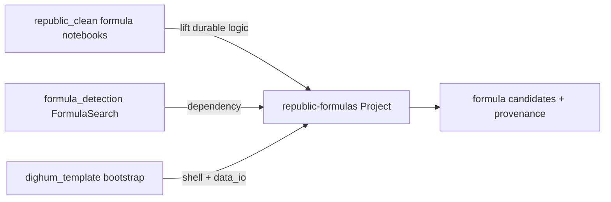

# Evolve formula work into this Project

## Goal

Turn this empty Project into a **dighum_template-based digital humanities pipeline** whose domain is **formulaic language detection** for REPUBLIC-style historical text — evolving from existing local work rather than copying it wholesale.

## Sources

| Source | Role |
|--------|------|
| [HoekR/dighum_template](https://github.com/HoekR/dighum_template) | Project shell: `bootstrap.sh`, `packages/data_io`, provenance, `wisdom/`, editor rules |
| `~/develop/formula_detection` (upstream: [marijnkoolen/formula_detection](https://github.com/marijnkoolen/formula_detection)) | Core library: `FormulaSearch` for templated/formulaic phrases in tokenized historical text |
| `~/develop/republic_clean/notebooks` (formula-related) | Applied REPUBLIC prototypes to lift into scripts/modules |

A readonly local survey is already running and will land at the Project store internal survey file; execution will use that inventory to pick which notebooks become first-class code.

## Approach (decided)

1. **Bootstrap correctly** with `dighum_template/scripts/bootstrap.sh` into this repo (or recreate layout to match what bootstrap produces). Working project slug: `republic-formulas`. Include `--with-wisdom`. No RPP/TRIFECTA addon unless survey shows a clear fit.
2. **Stop/retarget** the earlier cloud “derive as generic app” worker — this is a Python data pipeline, not a Next.js surface.
3. **Depend on `formula_detection`** (PyPI / editable local path) rather than forking the whole library into the repo. Put *project-specific* adapters, corpora iterators, and analysis scripts in this Project.
4. **Evolve notebooks → package + scripts**: identify durable formula workflows in `republic_clean` notebooks; reimplement the lasting paths as importable modules under the bootstrapped layout (e.g. `src/` or `packages/` per template conventions) plus thin CLI/scripts; keep 1–2 cleaned notebooks only as demos/docs if useful.
5. **First runnable slice**: sample tokenized corpus → `FormulaSearch` → candidate formulas written through `data_io` with provenance sidecars; README with how to run; basic tests around the adapter (not re-testing upstream library exhaustively).

## Out of scope for the first slice

- Full REPUBLIC corpus ETL or production-scale runs
- New UI / web app
- Rewriting upstream `formula_detection` itself
- Non-formula notebooks from `republic_clean`

## Execution owners

Work on **RiksMacBook** (self-hosted) so bootstrap and local sources stay on the same machine; push commits to this Project’s remote branch.
