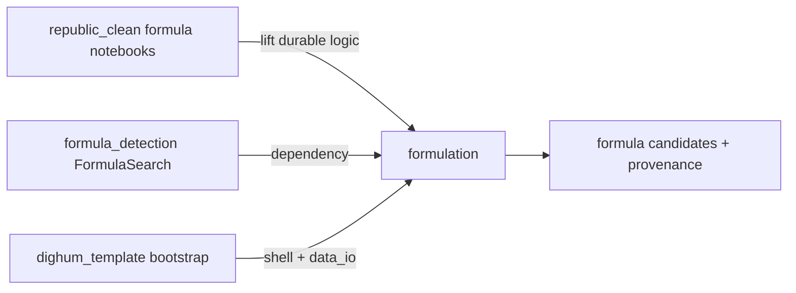

# Formula pipeline — cross-cutting plan

Headlines and the active checklist live in [`PLAN.md`](../PLAN.md). **M1 resumes at STEP2**; R1 is judged (stop after TF-IDF; [`plans/milestones/R1-aanstelling-retrieval.md`](milestones/R1-aanstelling-retrieval.md)). Research notions: [`docs/formula-conceptual-overview.md`](../docs/formula-conceptual-overview.md). Source notes: [`formulator-project-docs/`](../formulator-project-docs/).

## Goal

A dighum `data_io` pipeline whose domain is **formulaic language** in REPUBLIC-style resolutions: find, group, and type templated skeletons (openings, decisions, referrals, *hoedanigheden*) despite spelling variation and variable slots.

## Already done (do not redo)

| Work | Where |
|------|--------|
| dighum_template bootstrap (`--with-wisdom`, no domain add-on) | this checkout |
| Readonly survey of `formula_detection` + `republic_clean` formula notebooks | [`formulator-project-docs/internal-context/formula-sources.md`](../formulator-project-docs/internal-context/formula-sources.md) |
| Concrete first-slice port list | [`formulator-project-docs/internal-context/formula-port-list.md`](../formulator-project-docs/internal-context/formula-port-list.md) |
| S4 opening-candidate sample (271 n-grams; no span/position) | [`formulator-project-docs/internal-context/s4-opening-phrases-sample.md`](../formulator-project-docs/internal-context/s4-opening-phrases-sample.md) |
| Conceptual model (building blocks, gaps, position) | [`docs/formula-conceptual-overview.md`](../docs/formula-conceptual-overview.md) |

Domain package, adapters, and first-slice script are **not** in this checkout yet — implement against the port list below.

## Decided approach

1. **Depend on** PyPI `formula_detection` (`>=0.5.0,<0.6`). Do not fork or vendor the library. Transitive `fuzzy-search`. Runtime Python `>=3.12,<3.13` (upstream upper bound).
2. **Project layer only:** adapters, corpus/seed readers, analysis scripts, tests, one demo notebook.
3. **Notebooks are requirements + gold archaeology**, not application code. Lift durable *ideas*; do not copy the `republic_clean/notebooks` tree.
4. **ES-free first slice:** sample JSONL (with section / offsets) → token iterable → `FormulaSearch` → `save_semi_structured` candidates.
5. **In-repo tiers by default** (`.` / `./data/warm` / `./output` / `./data/cold`). External `/Volumes` overrides are optional later via gitignored `data_manifest.local.toml`.
6. Encode the conceptual model **lightly** in the first slice (position fields, gappy `extract_phrases` knobs, comments). Full building-block criteria are milestone 2, not a gate on the sample run.

## First-slice ports (milestone 1)

| Source | Port as | Destination in this repo |
|--------|---------|--------------------------|
| `FormulaSearch` + `extract_phrases` | dependency | `formula_detection` (PyPI) |
| `notebooks/resolution_iterables.py` / `corpus_iterables.ResolutionSentences` pattern | adapter | `formulation/adapters.py` — iterable of token lists (or dicts with `words`) |
| Sample REPUBLIC-style resolutions (offline) | warm dataset | `data/warm/datasets/corpus/sample_resolutions.jsonl` + manifest `sample_resolutions` |
| S4 opening n-grams | seed inventory | trimmed fixture under warm + optional local.toml override to the full file |
| `FormulaSearch` → candidates + provenance | script | `scripts/run_formula_search.py` via `data_io.save_semi_structured` |
| Adapter + search smoke tests | tests | `tests/test_adapters.py` (and seed tests) |
| Thin demo of the slice | notebook | `notebooks/01_formula_search_demo.ipynb` |

S4 full file on this machine (manifest / local.toml only): `~/develop/republic_ner_matching/output/s4_opening_phrase_candidates.jsonl`.

## Do not port

| Source | Reason |
|--------|--------|
| Entire `republic_clean/notebooks` tree | Scratch, ES-coupled, hard-coded local paths |
| `frm_frm_frm.ipynb`, `t_templ-*`, typo `fromulas_*` | Throwaway exploration |
| `clustering_formulas-output.ipynb` | Huge embedded outputs |
| Flair `frms_tagged/*.pt` | Out of scope; large private artefacts |
| Live Elasticsearch loaders | No full REPUBLIC ETL; sample JSONL only |
| Fork of `formula_detection` | Depend on the library |
| Full building-block criteria engine | Conceptual target; do not block first slice |
| Web UI | This is a Python data pipeline |

## Later lifts (milestones 2–3, then optional)

| Source / idea | Why | When |
|---------------|-----|------|
| Building-block criteria | Frequency ≠ formula | M2 |
| Gappy / templated patterns (`max_variables` / `max_skips`) | Formulas need not be contiguous | M3 (knobs may appear in M1) |
| Position in the resolution | Same cue ≠ same meaning | M3 (retain fields from M1) |
| Notebook gold CSVs (`csvs/`, `form_variant_*.csv`) | Labelled reference | after path-clean + licence check |
| `clustering_formulas.ipynb` idea | Year-sliced clustering | wrap `formula_detection.clustering` later |
| `formulas_and_hoedanigheden.ipynb` (logic only) | Phrases ↔ roles | after ES-free corpus exists |

Drive-backed `/Volumes` tiers are **optional**. Do not stall the first slice on them; in-repo roots are the default.
