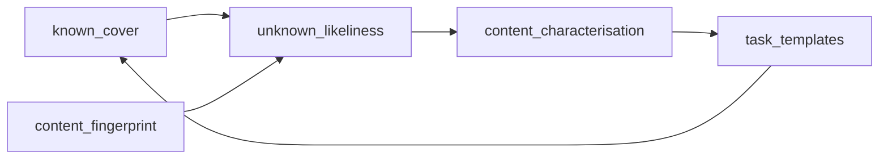

# T1 — Unknown-first typology (Track T spine)

**Status:** active (doctrine locked; STEPT1h PASS — 1780 high-unknown 0.72)  
**Steps:** [STEPT1h](../steps/STEPT1h-unknown-likeliness.md) → fingerprints bridge → content characterisation → task-template promotion  
**Supersedes as driver:** up-front closed inventories from expert knowledge; formula multiclass heads; flag sieves as typology (STEPT1e1 parked).

## Goal

Find **task-shaped structure you do not already name**, instead of classifying the corpus from incomplete knowledge.

Order:

1. **Unknown-likeliness** — how poorly a resolution is explained by the *already accepted* cover set.
2. **Content characterisation** — read / fingerprint / form-vs-substance on the high-unknown band.
3. **Task-templates** — promote a shape into `formula_templates` only after characteristics exist.

Formulas are **production machinery** (how SG work is regularised). Templates are **SG-task packages** (receive/inform, appoint, advise, decide, route…), not a catalogue of favourite phrases.

## Layers

| Layer | Job | Repo home |
|-------|-----|-----------|
| **Known cover** | Accepted evidence only (L1, R1/appointment, advies; later sparse As). Not flag rates; not provisional fillers alone | Freeze as cover set in STEPT1h |
| **Unknown-likeliness** | Per-id: how little the cover set explains | `formulation/unknown_likeliness.py` + `resolution_unknown_*` |
| **Content handle** | Fingerprint (or import from `republic_ner`) without typing | Later: manifest + thin adapter |
| **Content characterisation** | Sample high-unknown; form vs content; NOTES shapes | Later: provenanced sample + NOTES |
| **Task-templates** | Grow `formula_templates` as SG-task packages | Registry: promote only after characterisation |

## Locked constraints

- **Probability is not typology** (STEPT1g). Hit rate ≠ usefulness; ubiquitous = filler.
- Up-front classification from incomplete expert knowledge rediscovers only what you brought in.
- Formula detectors **support** known sparse shapes; they are not the corpus classifier.
- Do **not** build: general formula-type classifier; STEPT1e1 flag sieves as typology; closed `proposition_type` / scheme inventory as the discovery driver.

## Cover set (accepted only)

| Axis | Source | Notes |
|------|--------|-------|
| L1 missive receipt | `missive_receipt_labelled` positives | Known null-path receipt |
| R1 aanstelling | `aanstelling_selected` | Judged retrieval set |
| Appointment formula | `appointment_installation` present at operating cut | Accepted A |
| Advies formula / gold | `advies_geleesen` present **or** `advies_es_gold` | Accepted A / ES gold |

**Not cover:** solo `ontfangen_start`, raw `formula_documents` flag rates, ES `proposition_type` alone, scheme-only rows.

## Step order

| Step | Guide | Done when |
|------|-------|-----------|
| **T1h** | [STEPT1h-unknown-likeliness.md](../steps/STEPT1h-unknown-likeliness.md) | **done** (PASS; 2796 / high-unk 2015; L1 frac 0.24) |
| T1i | (fingerprints bridge — TBD) | Read-only fingerprint handles registered via `local.toml` |
| T1j | (characterise high-unknown — TBD) | NOTES shapes on high-unknown band; ≤1 sparse promotion if clear |
| T1k | (kind-support A — TBD) | Only for a named template that cleared characterisation |

## Out of scope here

Track F FormulaSearch, live ES, STEPT1e1, naming provincial-nomination as a type before characterisation, neural span eval.
