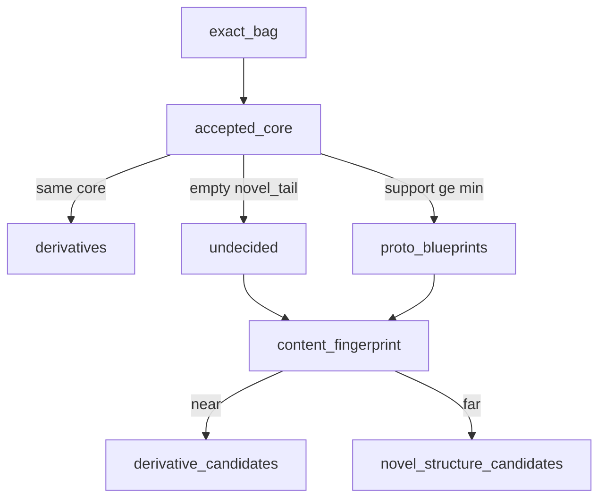

# T1 — Unknown-first typology (Track T spine)

**Status:** active (STEPT1k done: requeste opener A; STEPT1l done: routing subtypes separate, stop; STEPT1m opened: blueprint promotion)  
**Steps:** [STEPT1h](../steps/STEPT1h-unknown-likeliness.md) → [STEPT1i](../steps/STEPT1i-composition-unknown.md) → [STEPT1j](../steps/STEPT1j-empty-band-characterisation.md) → [STEPT1k](../steps/STEPT1k-requeste-formula-type.md) → [STEPT1l](../steps/STEPT1l-requeste-subtype-characterisation.md) → [STEPT1m](../steps/STEPT1m-blueprint-promotion.md) blueprint promotion  
**Supersedes as driver:** up-front closed inventories; formula multiclass heads; flag sieves (STEPT1e1 parked); NER ALIGNED_TO fingerprint as typology instrument.

## Research object

**Resolution formula-graph patterns.** Templates = combinations of formulas (SG-task packages).

| Term | Meaning |
|------|---------|
| **Blueprint** | Canonical formula-graph pattern for a task (promoted after characterisation) |
| **Derivative** | Variation of a blueprint (same structure; bag frills / wording) — not a new type |
| **Novel structure** | Not a derivative of any known blueprint |

Unknown *formulas* stay invisible until named. Operational unknown = **unexplained composition** (`empty` / `novel_tail`), not gold-set cover miss (STEPT1h stays auxiliary).

## Alikeness / variation vs structure

- **`accepted_core`** = bag ∩ {appointment, advies} — structure key; ontfangen = context.
- Same core → **derivatives**; different cores (support ≥ min) → **proto-blueprints**.
- Exact bags proliferate → catalogue only; do not mint types from bag n.
- **Fingerprints** (content cosine): undecided band — near proto-blueprint exemplars → derivative candidates; far / separate clusters → novel-structure candidates.

## Layers

| Layer | Job |
|-------|-----|
| Known formula hits | Presence at operating cuts |
| Graph / bags | Proto-blueprints + derivative mass + undecided |
| Content fingerprint | Undecided clustering + max_sim to proto exemplars |
| Characterisation | Read undecided/novel samples (later) |
| Task-templates | Promote blueprints only after characterisation |

## Cover set (STEPT1h — auxiliary)

L1 / R1 / appointment / advies gold-or-present. Useful triage crosstab; **not** the definition of composition-unknown.

## Step order

| Step | Guide | Done when |
|------|-------|-----------|
| **T1h** | [STEPT1h-unknown-likeliness.md](../steps/STEPT1h-unknown-likeliness.md) | done (PASS; cover-unknown 0.72) |
| **T1i** | [STEPT1i-composition-unknown.md](../steps/STEPT1i-composition-unknown.md) | **done** (PASS; proto=2; empty=1329; fp one mass @0.15) |
| **T1j** | [STEPT1j-empty-band-characterisation.md](../steps/STEPT1j-empty-band-characterisation.md) | **done** (PASS; rekest-headed multi-pocket; fp@0.45 sample-only) |
| **T1j2** | [STEPT1j2-empty-band-retrieval-probe.md](../steps/STEPT1j2-empty-band-retrieval-probe.md) | **done** (PASS; R1/L1 ~low on empty; contrast ≠ cluster) |
| **T1k** | [STEPT1k-requeste-formula-type.md](../steps/STEPT1k-requeste-formula-type.md) | **done** (A accepted; recall 0.898 PASS, FP 0.206 accepted not fixed) |
| **T1l** | [STEPT1l-requeste-subtype-characterisation.md](../steps/STEPT1l-requeste-subtype-characterisation.md) | **done** (PASS; referred 0.194 / granted_direct 0.709 / routing_unclear 0.050; length separates) |
| **T1m** | [STEPT1m-blueprint-promotion.md](../steps/STEPT1m-blueprint-promotion.md) | **not started** — wire requeste into accepted core, re-run STEPT1i 3-way, promote if low-noise |

## Out of scope here

Track F FormulaSearch, live ES, STEPT1e1, NER package import, minting types from cluster n.
