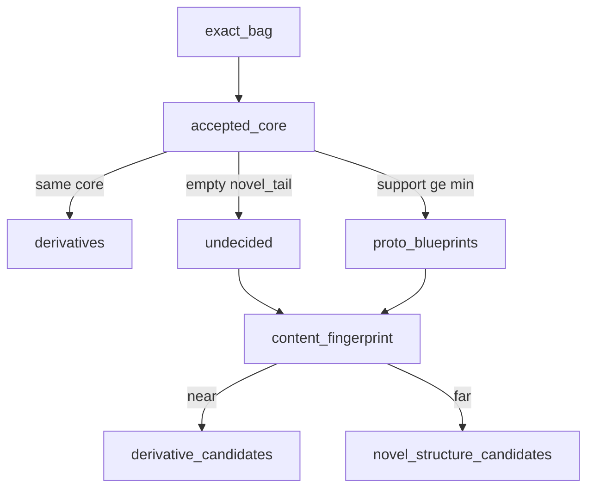

# T1 — Unknown-first typology (Track T spine)

**Status:** active — **growth edge = bubble-up** (limited cliff-medoid POC next). Hand hinge catalogue / STEPT1aj skim = later comparison only. STEPT1aa–ag = archaeology; full EM/DAG parked.
**Steps:** … → T1aa–ag **parked** → [STEPT1ah](../steps/STEPT1ah-hinge-archetype-seed.md) **done** → [STEPT1ai](../steps/STEPT1ai-hinge-witness-adjudicate.md) **done** → [STEPT1aj](../steps/STEPT1aj-hinge-witness-skim.md) **emit done**

**Supersedes as driver:** up-front closed inventories; formula multiclass heads; flag sieves (STEPT1e1 parked); NER ALIGNED_TO fingerprint as typology instrument; **5-gram family fold / residual patch ladder as typology growth**.

## Research object

**Resolution formula-graph patterns.** Templates = combinations of formulas (SG-task packages).

| Term | Meaning |
|------|---------|
| **Blueprint** | Canonical formula-graph pattern for a task (promoted after characterisation) |
| **Derivative** | Variation of a blueprint (same structure; bag frills / wording) — not a new type |
| **Novel structure** | Not a derivative of any known blueprint |

Unknown *formulas* stay invisible until named. Operational unknown = **unexplained composition** (`empty` / `novel_tail`), not gold-set cover miss (STEPT1h stays auxiliary).

## Alikeness / variation vs structure

- **`accepted_core`** = bag ∩ {appointment, advies} — structure key; ontfangen = context.
- Same core → **derivatives**; different cores (support ≥ min) → **proto-blueprints**.
- Exact bags proliferate → catalogue only; do not mint types from bag n.
- **Fingerprints** (content cosine): undecided band — near proto-blueprint exemplars → derivative candidates; far / separate clusters → novel-structure candidates.

## Layers

| Layer | Job |
|-------|-----|
| Known formula hits | Presence at operating cuts |
| Graph / bags | Proto-blueprints + derivative mass + undecided |
| Content fingerprint | Undecided clustering + max_sim to proto exemplars |
| Characterisation | Read undecided/novel samples (later) |
| Task-templates | Promote blueprints only after characterisation |

## Cover set (STEPT1h — auxiliary)

L1 / R1 / appointment / advies gold-or-present. Useful triage crosstab; **not** the definition of composition-unknown.

## Step order

| Step | Guide | Done when |
|------|-------|-----------|
| **T1h** | [STEPT1h-unknown-likeliness.md](../steps/STEPT1h-unknown-likeliness.md) | done (PASS; cover-unknown 0.72) |
| **T1i** | [STEPT1i-composition-unknown.md](../steps/STEPT1i-composition-unknown.md) | **done** (PASS; proto=2; empty=1329; fp one mass @0.15) |
| **T1j** | [STEPT1j-empty-band-characterisation.md](../steps/STEPT1j-empty-band-characterisation.md) | **done** (PASS; rekest-headed multi-pocket; fp@0.45 sample-only) |
| **T1j2** | [STEPT1j2-empty-band-retrieval-probe.md](../steps/STEPT1j2-empty-band-retrieval-probe.md) | **done** (PASS; R1/L1 ~low on empty; contrast ≠ cluster) |
| **T1k** | [STEPT1k-requeste-formula-type.md](../steps/STEPT1k-requeste-formula-type.md) | **done** (A accepted; recall 0.898 PASS, FP 0.206 accepted not fixed) |
| **T1l** | [STEPT1l-requeste-subtype-characterisation.md](../steps/STEPT1l-requeste-subtype-characterisation.md) | **done** (PASS; referred 0.194 / granted_direct 0.709 / routing_unclear 0.050; length separates) |
| **T1m** | [STEPT1m-blueprint-promotion.md](../steps/STEPT1m-blueprint-promotion.md) | **done** (PASS; undecided 0.475→0.140 on 1780 comparison year; `appointment_installation`/`advies_geleesen`/`requeste_geleesen` promoted to `role: "blueprint"`) |
| **T1n** | [STEPT1n-missive-formula-type.md](../steps/STEPT1n-missive-formula-type.md) | **done** (A accepted; recall 0.887 PASS on ES `missive` gold (177k rows); FP 0.11 accepted — expected ontfangen+/ES boundary fuzziness; model trails wording baseline, new caveat) |
| **T1o** | [STEPT1o-missive-blueprint-promotion.md](../steps/STEPT1o-missive-blueprint-promotion.md) | **done** (PASS, cleaner than T1m; empty 0.140→0.122; `filler_star` 0.425→0.000 — bare `ontfangen_start` mass resolves to a real type; `missive_ontfangen` promoted to `role: "blueprint"`) |
| **T1p** | [STEPT1p-clause-chain-probe.md](../steps/STEPT1p-clause-chain-probe.md) | **done** (G1 FAIL / G2 PASS — appointment clause order is rigid, so chains ≡ bags; chain gain needs order variation, multiplicity, or position variation) |
| **T1q** | [STEPT1q-formula-retrieval.md](../steps/STEPT1q-formula-retrieval.md) | **done** (PASS; G1: substring loses to DAG on missive, 0.985/0.031 vs best substring 0.995/0.133 — Doc B's "substring may win" rested on a recall-only, 31%-mislabelled comparison; requeste's 0.182 FP is a cut artifact over a bimodal gold population (512/1380 short-form, median 69 words), not model imprecision — cut 6.3 gives FP 0.036 at 0.625 recall, user accepted 4.5/0.18 as the operating point; G3 PASS both types; G5 sampling-robustness check and STEPT1q2 span hand-read still owed) |
| **T1r** | [STEPT1r-requeste-low-band.md](../steps/STEPT1r-requeste-low-band.md) | **done** — split confirmed (`op_de_requeste` / `requeste_op_de`); letter/missive short-opener parallel parked; L2 still later |
| **T1s** | [STEPT1s-requeste-op-de-formula-type.md](../steps/STEPT1s-requeste-op-de-formula-type.md) | **done** — A accepted (cut 4.5; FP 0.064 accepted; cross-fire 0.02) |
| **T1t** | [STEPT1t-requeste-op-de-blueprint-promotion.md](../steps/STEPT1t-requeste-op-de-blueprint-promotion.md) | **done** — promoted; empty unchanged 0.122; dual-opener cores 188/109/7 (dominant 1.0); no solo short core |
| **T1u** | [STEPT1u-empty-band-5core.md](../steps/STEPT1u-empty-band-5core.md) | **done** — empty n=342; rekest head gone; voordracht/rapport/conclusie pockets; opener treadmill declined |
| **T1v** | [STEPT1v-formula-reduction-l2.md](../steps/STEPT1v-formula-reduction-l2.md) | **done** — soft optional ablation no-op (identical R/FP/cut) |
| **T1v2** | [STEPT1v2-formula-reduction-hard-drop.md](../steps/STEPT1v2-formula-reduction-hard-drop.md) | **done** — hard-drop moves metrics; Requeste = FP/specificity hinge; five scaffolding slots; leave-k skipped |
| **T1w** | [STEPT1w-rapport-formula-type.md](../steps/STEPT1w-rapport-formula-type.md) | **done** — A accepted (R 0.895 / FP 0.006); promote separate |
| **T1x** | [STEPT1x-rapport-blueprint-promotion.md](../steps/STEPT1x-rapport-blueprint-promotion.md) | **done** — promoted; empty 0.122→0.107; solo rapport 42 @ 1.0 |
| **T1y** | [STEPT1y-opener-candidates-driver.md](../steps/STEPT1y-opener-candidates-driver.md) | **done** — queue seeded; driver write-back gates PASS; no voordracht mint |
| **T1z** | [STEPT1z-formula-sequence-matrix.md](../steps/STEPT1z-formula-sequence-matrix.md) | **done** — row-stochastic P(next\|current) + harvest; nested-surface caveat |
| **T1aa** | [STEPT1aa-phrases-5gram-profile.md](../steps/STEPT1aa-phrases-5gram-profile.md) | **done** — Pass A freq + rare/protected sidecar (1780); **archaeology** |
| **T1ab** | [STEPT1ab-formula-family-fold.md](../steps/STEPT1ab-formula-family-fold.md) | **done** — nest + variant fold → 1978 families; **archaeology** |
| **T1ac** | [STEPT1ac-sequence-matrix-family-impact.md](../steps/STEPT1ac-sequence-matrix-family-impact.md) | **done** (catalog) — exemplar harvest + soft containment 0.54 vs STEPT1z; **archaeology** |
| **T1ad–ag** | overlap prove/wire, type-from-place, residual sweep | **done** (code) — **parked**; not catalogue growth |
| **T1ah** | [STEPT1ah-hinge-archetype-seed.md](../steps/STEPT1ah-hinge-archetype-seed.md) | **done** — `formula_hinge_candidates` n=20 (+ 4 decision polarity pockets, null canonic) |
| **T1ai** | [STEPT1ai-hinge-witness-adjudicate.md](../steps/STEPT1ai-hinge-witness-adjudicate.md) | **done** — char TF-IDF soft membership; 1261 witnesses → near 20 / mid 72 / far 1169 |
| **T1aj** | [STEPT1aj-hinge-witness-skim.md](../steps/STEPT1aj-hinge-witness-skim.md) | **emit done** — near+mid xlsx (92); human fill → ingest owed |

## Out of scope here

Track F FormulaSearch, live ES, STEPT1e1, NER package import, minting types from cluster n. Downstream re-wiring of `missive_ontfangen` / `requeste_geleesen` into `formula_type_order.py` / `formula_type_position.py` / `residual_structure.py` / `formula_type_composition_graph.py` / `unknown_likeliness.py` (flagged by STEPT1m, doubled by STEPT1o) — separate follow-up, not mechanical.
